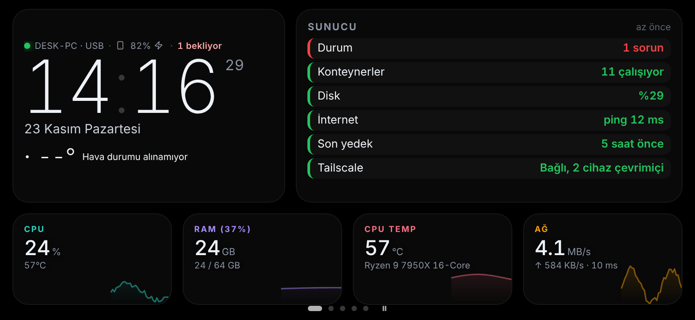
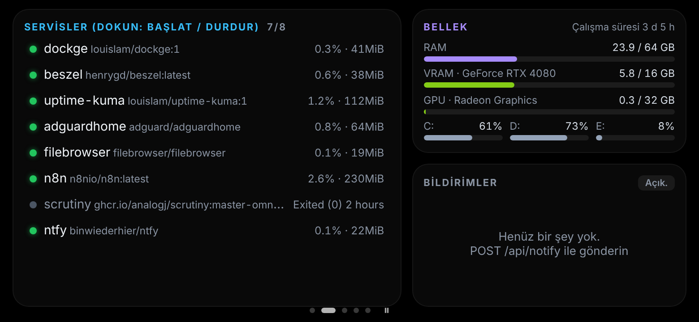
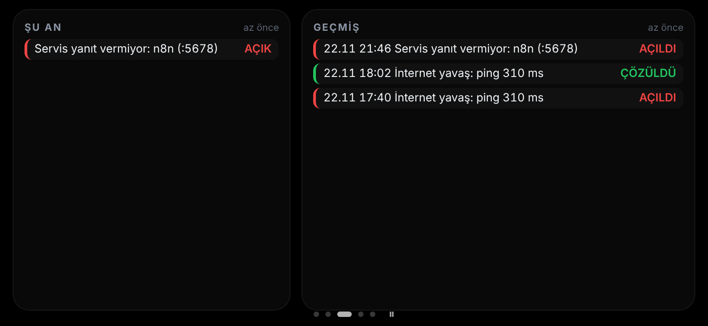
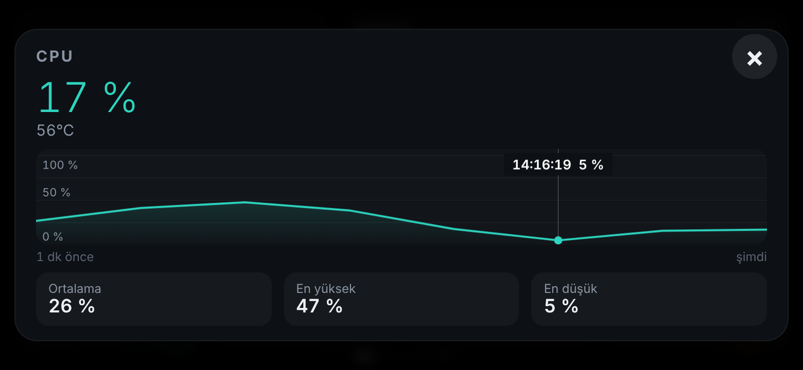
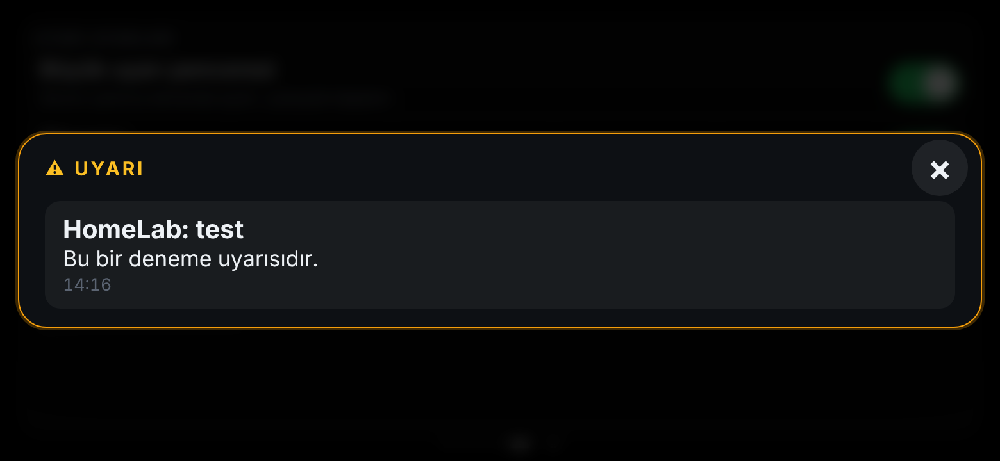
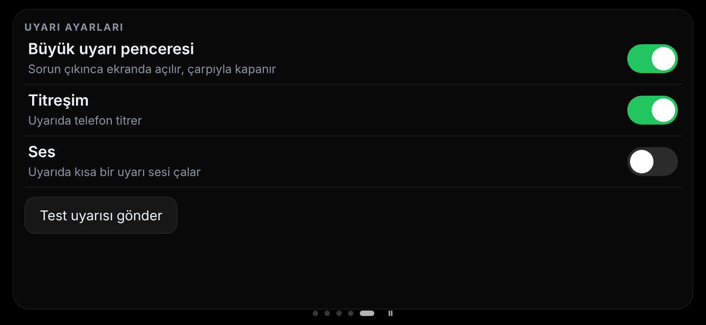
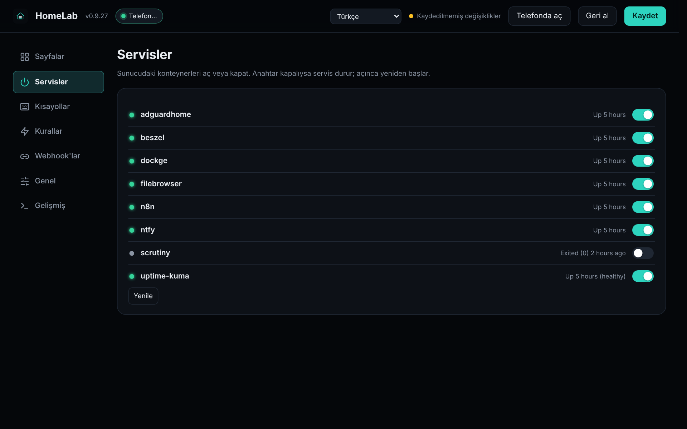

# HomeLab — One-Click Installer

[Türkçe: README.tr.md](README.tr.md) · Repository: https://github.com/Kleanty/HomeLab

**If this is your first install, read [`INSTALL-GUIDE.md`](INSTALL-GUIDE.md) first.** This package is run after Linux Mint 22.x has been installed on the new computer; it does not install the operating system itself.

This package turns a fresh **Linux Mint 22.x Cinnamon 64-bit (Ubuntu 24.04 / noble, amd64)** computer into a basic HomeLab server.

> **Important:** This package does not install the Linux Mint operating system from USB by itself. First install Linux Mint on the computer and log in to the desktop. Then unpack the package and run `KUR.sh` with your normal user account. Before running it directly on an existing HomeLab server, take a backup and review the existing Compose files.

## Screenshots

The following are example images taken with demo data.

| | |
|---|---|
|  |  |
|  |  |
|  |  |

The settings page on the server (`http://127.0.0.1:8765`, opened in the server's own browser; it asks for the username and password you chose during the installation): you manage services with on/off switches.



## Test status and licence

The installation has been tested on a real machine running Linux Mint 22.x (including RustDesk). After the first install on your own hardware, check the state with `bash TANI.sh`.

This project is shared under the [MIT Licence](LICENSE). The software is provided "as is"; you use it at your own responsibility.

## What gets installed?

### System packages and services

- Docker Engine, Docker Compose and Buildx
- OpenSSH Server
- Samba file sharing
- Syncthing
- Fail2ban (basic brute-force protection for SSH)
- Restic (encrypted backup tool; an external target is needed for automatic jobs)
- SQLite3 (to prepare consistent copies of running SQLite databases)
- smartmontools, nvme-cli and lm-sensors (disk/NVMe/sensor diagnostics)
- systemd-journald logs are kept persistently; total size is limited to 500 MB and retention to 1 month
- UFW package (the firewall is **not enabled**)
- Docker log rotation: on a fresh install the `local` driver, 10 MB and at most 3 files; an existing `daemon.json` is preserved
- Hardware detection: CPU/RAM/graphics card and disks are only listed for information. **The graphics card (NVIDIA) driver is not installed by this package.**
- Ollama: on the first install the fixed model [`qwen2.5:1.5b-instruct-q4_K_M`](https://ollama.com/library/qwen2.5/tags) is downloaded (about 986 MB) and runs **on the CPU**. If there is less than 2 GiB of free disk space the download is skipped and the reason is reported; you can add any model you like later.
- Avahi/mDNS: devices on the local network that support it can try to reach the machine as `computer-name.local`; no fixed IP is configured on the router
- Docker port lock: the `homelab-docker-lan-only` service blocks new internet-originated connections to the ports Docker publishes; the local network (10/8, 172.16/12, 192.168/16), Tailscale (100.64/10) and localhost stay open. It only affects Docker traffic (IPv4); published ports are pinned to IPv4. Beszel Agent (45876), which uses the host network, is outside this filter. SSH/Samba/UFW are unchanged
- **HomeLab Panel** (phone panel): turns an old Android phone into a server panel. The HomeLab agent is built from this repository (`agent/`) with GitHub Actions and uploaded to the `v<version>` release; KUR.sh downloads it, verifies SHA-256 and runs it as a systemd user service (`homelab-agent`); it does not update itself. adb is installed too (for the USB connection). On the first install 6 pages are prepared: HomeLab (clock, status list, CPU/RAM/temperature/network), Services (tap a container: start / stop / restart), Alerts (open problems and history), System, Processes and Shortcuts. Tapping the cards opens a large chart window. The health check tests internet (ping) and services every 2 minutes; if there is a problem a large alert opens on the phone. GPU temperature needs the vendor driver; since the installer does not install an NVIDIA driver, there is no GPU widget by default. On the server, you edit the pages on the HomeLab settings page at `http://127.0.0.1:8765`, and start/stop Docker containers with on/off switches on its **Services** tab (the Services page of the phone panel does the same; your user must be in the `docker` group, so log out and back in once after the install). The interface is in Turkish, with an AMOLED + turquoise theme.
- Tailscale and RustDesk (remote desktop; connects without opening ports on the modem)
- Sleep/suspend lock so the server does not go to sleep (the power-button setting is preserved) and automatic login (LightDM; left alone if already set)

### Docker services

| Service | Address / port | Description |
|---|---|---|
| Dockge | `http://SERVER-IP:5001` | Docker Compose management |
| Beszel Hub | `http://SERVER-IP:8090` | System and container monitoring hub |
| Uptime Kuma | `http://SERVER-IP:3001` | Service availability and uptime |
| Scrutiny | `http://SERVER-IP:8081` | HDD/SSD/NVMe SMART health tracking |
| File Browser | `http://SERVER-IP:8080` | File interface |
| n8n | `http://SERVER-IP:5678` | Automation |
| Ollama API | `http://127.0.0.1:11434` | Server's localhost only; the Qwen model is downloaded automatically after the RAM/disk check |
| Your own website (Caddy) | `http://127.0.0.1:8088` | Empty placeholder page that you replace with your own site; listens on 127.0.0.1 only unless you change the Caddyfile/compose port; domain/HTTPS is configured later |
| AdGuard Home | `:3000` by IP, then `:3002`; DNS `:53` | Optional; binds only to the selected LAN IP |

AdGuard Home is asked about separately during installation. The router's DNS/DHCP settings are not changed and the AdGuard DHCP server is not enabled.

### Beszel Agent

Beszel Hub is installed automatically. The Agent Compose file is prepared too; because the Agent needs a key/token that exist only after the first admin account and system record are created in the Hub, it is started with a separate helper:

```bash
bash /srv/homelab/tools/configure-beszel-agent.sh
```

First open `http://SERVER-IP:8090`, create a system record in Beszel via **Add System** and get the KEY/TOKEN values the Hub gives you. The helper writes them to a root-readable `.env` file with `0600` permissions and starts the Agent container. On the Hub side use the server's LAN IP and port `45876`. The Agent is not started or stopped from a panel; once its container exists it appears in the Services list of the phone panel and of the settings page.

The Agent container mounts `/var/run/docker.sock` read-only for Docker statistics. Mounting the Docker socket read-only does not make API access truly read-only; the Docker socket is a highly privileged interface. So the Agent should only run on a local server you trust, and its port must not be forwarded to the internet.

### Scrutiny disk access

The installer detects physical disks with `lsblk` and passes only those disks to the Scrutiny container as `/dev/...` mappings (USB/removable disks and zram are excluded; the container could not start if one were removed). SATA/SAS disks are passed with their own device paths; NVMe disks are passed with the NVMe controller device that the Scrutiny documentation asks for. The `SYS_RAWIO` capability is added. If NVMe is detected, the `SYS_ADMIN` capability is optionally asked about; the default choice should be **No**. This capability is broad and should be considered separately only if NVMe SMART data cannot be read. `--privileged` is not used.

If Scrutiny looks empty, it may mean the disk does not support SMART data, a USB bridge blocks SMART passthrough, or NVMe needs the extra capability. SMART data is not guaranteed for every disk behind RAID/USB converters.

## Restic automatic backup

The Restic package is installed; at the end of the install an external disk is asked about as the target for automatic backup. If no external disk is connected this step can be skipped:

```bash
sudo bash /srv/homelab/tools/setup-restic-backup.sh
```

The tool:

1. Asks for the backup repository path on a separately mounted filesystem. It refuses to create a backup inside `/srv/homelab` or on the system disk's root filesystem; if the sources are block devices it also checks whether they are on the same physical disk as the system disk.
2. Asks twice for a Restic encryption password of at least 20 characters.
3. Stores the password in `/etc/restic/homelab-password` with root-only `0600` permissions. Also save the password in a secure password vault; if it is lost the backup cannot be opened.
4. Initialises the Restic repository and enables the daily backup and weekly integrity check timers.

Schedule and retention policy:

- A backup every day at about 03:15; jobs missed at boot are caught up.
- 14 daily, 8 weekly and 12 monthly snapshots are kept; cleaning old snapshots and `prune` run at the end of the backup job.
- Weekly Restic repository integrity check.
- If the backup disk is mounted by the desktop session under `/media/...` or `/run/media/...`, the installer warns. For the timer to see the disk without a desktop login, a fixed mount point mounted at boot is needed (preferably a UUID-based `/etc/fstab` entry or a systemd mount). The installer does not change this critical system file on its own.
- For SQLite databases it tries to prepare a consistent copy from the live database with `sqlite3 .backup`.
- `/srv/homelab`, the SSH/Samba configuration and the user's `.ssh` directory are covered.

Start the first backup manually:

```bash
sudo systemctl start homelab-restic-backup.service
sudo systemctl status homelab-restic-backup.service --no-pager
sudo journalctl -u homelab-restic-backup.service -n 100 --no-pager
```

Check the snapshot list and a sample restore:

```bash
sudo bash -c 'set -a; . /etc/restic/homelab.env; set +a; restic snapshots'
sudo mkdir -p /tmp/homelab-restore-test
sudo bash -c 'set -a; . /etc/restic/homelab.env; set +a; restic restore latest --target /tmp/homelab-restore-test --include /srv/homelab/web/public/index.html'
```

After the restore test you can delete the temporary `/tmp/homelab-restore-test` directory. This example restores only a single small web file; it does not unpack the whole backup into a temporary directory and fill up the system. The `--include` path must match the path inside the snapshot; for your own file, rely on the output of `restic ls latest`.

Check the timers:

```bash
systemctl list-timers 'homelab-restic*'
```

### Full restore (on a newly installed machine)

1. Complete the normal `KUR.sh` install, connect the external backup disk and recreate `/etc/restic/homelab.env` and the password file (`/etc/restic/homelab-password`). Without the password the backup cannot be opened.
2. Stop the services: `cd /srv/homelab && sudo docker compose -f <stack>/docker-compose.yml down` (for each stack).
3. First restore to a temporary directory and check the contents: `sudo bash -c 'set -a; . /etc/restic/homelab.env; set +a; restic restore latest --target /srv/restore-tmp'`
4. SQLite databases are backed up as consistent snapshots rather than live files: `/srv/restore-tmp/var/lib/homelab-restic/staging/sqlite/.../<name>.snapshot`. When putting a database back, copy the relevant `.snapshot` file to the original path (`/srv/homelab/appdata/...`) under its original name; do not copy while the service is running.
5. Move the remaining files from `/srv/restore-tmp/srv/homelab` into `/srv/homelab` with `sudo rsync -a`, then start the services again.
6. These steps have not been tried on a real machine; after the first backup, do a trial restore into an empty directory.

If the backup target disk is not connected the job fails on purpose; it never silently writes a backup to the system disk. Ollama model files are under `/srv/homelab` too, so they are included in the backup and the first backup can be large. Choose the external disk's capacity accordingly. After the backup completes, do a restore test to a different location; the fact that a backup is being taken does not by itself prove that it can be restored.

Instead of keeping the Restic repository on an SMB/CIFS share, a directly attached USB/SATA disk or a suitable SFTP/S3/REST target is preferred. Do not keep the password and the backup repository as a single copy on the same physical disk.

## 1. Install Linux Mint

1. Download the Linux Mint 22.x Cinnamon 64-bit ISO from https://linuxmint.com/download.php.
2. Prepare the USB stick with Mint USB Image Writer or Balena Etcher.
3. Boot the computer from the USB stick and install Linux Mint.
4. If you use the erase-disk option during installation, choose the correct disk; the data on that disk is erased.
5. Create a normal user, log in to the desktop, connect to the internet and complete the updates.

## 2. Unpack and run the package

Unzip the ZIP. `KUR.sh`, `setup-restic-backup.sh`, `configure-beszel-agent.sh` and the other helper files must stay in the same parent folder.

```bash
chmod +x KUR.sh
./KUR.sh
```

`sudo` may ask for your password. At the start, the installer first asks **Language / Dil** (English or Türkçe); your choice is used for all installer messages, notifications and the helper scripts. Then it asks for one username and one password (the password is asked twice, at least 14 characters; if it is too short or does not match, it says why and asks again). The same password is used for the settings page login, Samba, RustDesk, ntfy and Syncthing; Samba uses the Linux account as the username. After that it proceeds without asking questions. Do not close the terminal during the install. The install log is kept under `~/HomeLab_Logs/kurulum-*.log`; at the end of the install the IP, links, RustDesk ID and ntfy details are written to `~/HomeLab_Logs/kurulum-ozeti-*.txt` and shown on screen (it contains secrets and is not written to the log). If an error occurs, the terminal shows the error line, exit code, command and log path. Before sharing the log, review it for private IPs or usernames.

After the install, log out and back in once (docker and plugdev groups): USB pairing and Docker control only work after that.

During the install:

- Tailscale, RustDesk, AdGuard, automatic security updates and a Timeshift snapshot are installed/taken without questions. For the Tailscale login you need to open the link shown in the summary at the end of the install in a browser (the install does not wait). Restic needs an external disk, so it is set up with a separate tool.
- AdGuard Home is installed automatically; the server's local-network IPv4 address is found automatically (if it cannot be found the step is skipped and a warning is written).
- The processor, RAM, graphics card and disks are detected and listed automatically; no graphics card driver or GPU configuration is done, and Ollama runs on the CPU.
- Regardless of the amount of RAM, `qwen2.5:1.5b-instruct-q4_K_M` is explicitly downloaded on the first install. The model file in the official Ollama library is about 986 MB. Only if the HomeLab disk has less than 2 GiB free is the download skipped, to protect storage, and a warning is shown. If needed, the user can download another model by hand later.
- The disk list is detected for Scrutiny; if NVMe is present you are asked whether extra capability should be granted.
- The username and a password of at least 14 characters are taken (they are also the settings page login).
- The same password is used for Samba (the username is the Linux account).
- If the external backup disk is connected, Restic automation can be configured.
- If Tailscale is selected, the login step is asked at the end of the install.
- The Cinnamon power button is set to shut down directly, with the previous user preference backed up; a restart is needed for the systemd setting.

Packages and Docker images are downloaded from the internet. The install may take a while depending on connection speed.
If a Docker stack cannot start (image could not be downloaded, port conflict, etc.) the install does not stop; it is written to the warning list and at the end it shows which stack must be started by hand.

## 3. First steps after the install

If any service does not start, run `TANI.sh` from the package as a normal user:

```bash
bash TANI.sh
```

The report is created under `~/HomeLab_Logs/tani-*.txt`. This report checks service states, Docker containers, Compose validation, ports and Restic/Agent status; it does not print password and token values.


1. Create the Beszel Hub admin account at `http://SERVER-IP:8090`.
2. In the Hub start the system record with **Add System**; run `configure-beszel-agent.sh` with the key and token given.
3. Check the Scrutiny disk status at `http://SERVER-IP:8081`.
4. If AdGuard was selected, complete the first-run wizard at `http://ADGUARD-LAN-IP:3000`. After setup, the admin interface is at `http://ADGUARD-LAN-IP:3002`. Change the clients' DNS settings by hand only after you have tested it and fixed the server IP with a DHCP reservation/static IP.
5. Check your own website (Caddy), an empty placeholder page that you replace with your own site, on the server itself at `http://127.0.0.1:8088`. The web files are in `/srv/homelab/web/public` and the Caddy configuration in `/srv/homelab/config/caddy/Caddyfile`. On a clean install these can be edited by your normal Linux account. After changing the Caddyfile, reload the configuration with `sudo docker compose -f /srv/homelab/compose/web/compose.yaml exec caddy caddy reload --config /etc/caddy/Caddyfile`.
6. If Restic is configured, start the first backup and check the systemd log.

### Notification, security and maintenance tools

- **ntfy (notifications, `http://SERVER-IP:2586`):** The install creates a random topic name and a `homelab` user (`sudo cat /etc/homelab-installer/ntfy.env`). In the ntfy app on your phone add the server address, this user and the topic. Tailscale is needed to receive them away from home. `homelab-health-check` checks every 10 minutes for disk above 90%, failed services, stopped containers and backups older than 48 hours; it notifies only on a new problem and when it is fixed. A notification is also sent when the Restic backup/check services fail.
- **Timeshift:** Recommends taking a system snapshot before the install (Timeshift must already be set up).
- **Automatic security updates (optional):** Ubuntu security repository only; Docker packages are excluded; no automatic reboot. Because the default setting does not match on Mint, the source is written explicitly.
- **SSH key login:** `bash /srv/homelab/tools/harden-ssh.sh` checks your key and the permissions, asks you to type that you verified key login, then disables password login. To undo, use `--geri-al`.
- **Web login reset:** if you forget the settings page login, run `bash /srv/homelab/tools/reset-web-login.sh` (no restart needed).

### Do these immediately on first login

Dockge, Beszel, Uptime Kuma and n8n let whoever opens them first create the admin account; create it yourself right after the install. The File Browser username is `admin`; the first password is generated randomly and written to the log (`sudo docker logs filebrowser`). Scrutiny has no login screen. Add a password to the Syncthing interface (127.0.0.1:8384). The same list is printed on screen at the end of the install.

## 4. HomeLab settings page login

- The only HomeLab web page is the agent's settings page, `http://127.0.0.1:8765`, in the server's own browser.
- It asks for a login (HTTP Basic; the browser asks once per session): the same username and password you chose during the installation.
- The login is stored as a PBKDF2 hash in `~/.config/HomeLab/web-login` (mode 600).
- Local scripts that push alerts (`/api/info`, `/api/notify`, `/api/push`) stay open without a login because the port is loopback-only.
- The **Services** page of the settings and of the phone panel start/stop Docker containers; your user must be in the `docker` group (log out and back in once after the install).
- If you forget the login: `bash /srv/homelab/tools/reset-web-login.sh` (no restart needed).

Remember that a Linux account added to the Docker group can obtain near-root privileges through Docker. The install records the first membership; on removal it only reverts a membership that this package added.

## 5. Data and configuration locations

- Compose files: `/srv/homelab/compose/`
- Persistent application data: `/srv/homelab/appdata/`
- Shared files: `/srv/homelab/data/`
- Website files: `/srv/homelab/web/public/`
- Caddy configuration: `/srv/homelab/config/caddy/Caddyfile`
- Helper install tools: `/srv/homelab/tools/` (`setup-restic-backup.sh`, `configure-beszel-agent.sh`, `reset-web-login.sh`, `harden-ssh.sh`, `lang.sh`)

Compose files are kept root-owned; use `sudo` to change them. Existing Compose files are not overwritten. No broad `chown -R` is applied to existing data folders.

## 6. Security and external access limits

- The UFW package is installed but the firewall is not enabled; a wrong rule could cut off SSH/RustDesk access.
- Fail2ban is enabled against SSH login attempts.
- Some Docker services publish ports on LAN interfaces. Do not forward ports 22, 445, 5001, 8090, 3001, 8081, 8080, 5678, 53 or 45876 on the router to the internet.
- Important: traffic to ports published by Docker can bypass UFW rules. Simply running `ufw enable` does not secure these container ports; before any internet exposure, the Docker `DOCKER-USER` chain and a LAN/Tailscale access policy must be designed separately.
- Your own website (Caddy) is served only on `127.0.0.1:8088` unless you change the Caddyfile/compose port.
- AdGuard binds to the selected LAN IP; the router DNS or DHCP settings are not changed.
- No connection is made to a Cloudflare account, and no DNS record/Tunnel/Access policy is created.
- A fixed public IP is not needed on a home connection; Cloudflare Tunnel makes an outbound connection from the server. However, the domain must be in Cloudflare DNS, and a Tunnel token and hostname mapping are needed; these will be supplied by the user in a later stage. The local network IP may change with DHCP; a DHCP reservation on the router is optional. On devices that support mDNS the `computer-name.local` name can be tried.
- Domain, HTTPS, Cloudflare Tunnel and Access configuration for the public website is a separate later stage.

Recommended final architecture:

- `yourdomain.com`: public personal website

Do not open external access before the Cloudflare side is configured separately.

## 7. Running on top of an existing installation

This package is designed primarily for a **clean Linux Mint 22.x install**. Some operations can be re-run:

- Existing Compose YAML files are not overwritten.
- Existing application data is not deleted.
- Missing new service stack files are added.

However, existing Compose projects are re-applied with `up -d`; the Docker daemon setting, service versions and existing container behaviour may change. Before running directly on an existing server, back up `/srv/homelab` and the Docker configuration. Adding an Agent to a Beszel Hub installed differently before, and AdGuard port/IP conflicts, must also be checked separately.

## 8. Check commands

```bash
sudo docker ps
sudo docker compose ls --all
sudo systemctl status fail2ban ssh smbd docker systemd-journald --no-pager
sudo timedatectl status
sudo nvme list
sudo systemctl status homelab-restic-backup.timer homelab-restic-check.timer --no-pager
```

## 9. Known limits / next stages

- The Linux Mint operating system is not installed automatically from USB.
- Graphics card driver and GPU acceleration are not in this package; Ollama always runs on the CPU. If you wish, you can install the driver and the NVIDIA Container Toolkit by hand afterwards.
- The model choice does not change with hardware; every install uses the `qwen2.5:1.5b-instruct-q4_K_M` model. Response speed on the CPU depends on the processor and RAM.
- The AdGuard DNS setting is not applied to the router automatically; the static DHCP reservation and client DNS setting are done by the user.
- Caddy does not configure the domain, HTTPS or Cloudflare Tunnel on its own.
- Scrutiny cannot guarantee SMART passthrough of USB-SATA bridges or RAID controllers.
- UPS/NUT configuration is not added without knowing a real UPS model and connection type.
- Automatic operating-system updating is not enabled; run updates in a controlled way through Mint Update Manager. A firewall and an SSH key policy should be applied to the server separately.
- Beszel Agent needs Docker socket access for Docker statistics; this is highly privileged access.
- RustDesk is downloaded from the official GitHub releases (.deb); if GitHub provides a checksum (digest) the SHA-256 is verified, then it is installed with apt. If the download or verification fails the install is skipped and a warning is written.
- The RustDesk permanent password is asked at the start of the install and set with `rustdesk --password` (while the command runs, the password may briefly be visible in the process list). If it cannot be set a warning appears; you can set it by hand under RustDesk > Settings > Security.
- In headless (no monitor) operation the screen may come up black; plug in an HDMI/DisplayPort 'dummy' plug. Linux Mint Cinnamon uses X11, so RustDesk is compatible (limited on a Wayland session).
- Sleep prevention: the sleep/suspend/hibernate targets are masked, lid close and idle sleep are ignored, and screen blanking and the screen lock are turned off in Cinnamon. The previous Cinnamon values are backed up and restored by KALDIR.sh. Because the screen lock is off, anyone with physical access to the computer sees the desktop.
- Automatic login (LightDM) is enabled automatically during the install; anyone with physical access to the computer can get into the desktop.
- When uploading to GitHub: .gitignore and .gitattributes (LF line endings) are ready in the package; if you upload from Windows the execute permission is lost, so run the scripts with `bash KUR.sh`.


## 10. Removing a previous HomeLab installation

If you did a clean Linux Mint install you do not need to run `KALDIR.sh`. This tool is only for removing a previous HomeLab installation on the same computer.

`KALDIR.sh` in the package removes this installation's known containers, the Restic timers and the HomeLab system configuration. Run it as a normal user:

```bash
bash KALDIR.sh
```

The process asks for the `HOMELAB-KALDIR` confirmation. By default it keeps the application data in `/srv/homelab`, Ollama models, shared files, web content and local backups. If you want to delete everything you must additionally type `HOMELAB-DATASI-SIL`. This choice cannot be undone. The external Restic repository is never deleted under any condition.

Removing system packages is a separate, second choice. The newer version records the existing packages before the install and, during removal, tries to remove only the packages this install added; it keeps previously installed packages. In particular, if OpenSSH is removed your remote connection may be cut. If there is no ownership record for earlier packages, the package-removal step is skipped so that no package is deleted by mistake. So use it only while sitting at the computer. If package removal is not selected, KUR.sh may reinstall missing services on its next run.

The removal log is kept under `~/HomeLab_Logs/kaldirma-*.log`. Some system settings the install added are tracked with marker files; the removal script preserves pre-existing configuration as far as possible. The removal script has not been run on a real Linux Mint computer in this environment; only Bash syntax and static content checks have been done. Back up important data before removal.

## Phone agent and app: build order

Repository: https://github.com/Kleanty/HomeLab

0. Once: in the repository choose **Settings > Pages > Source: GitHub Actions**, then run **Actions > pages > Run workflow**. The phone pairing QR points to the page `https://kleanty.github.io/HomeLab/pair/` (the code is in the `site/` folder); if this page is not published the QR does not open.
1. The phone app is built by GitHub Actions: in the GitHub repository run **Actions > build-agent > Run workflow** (then build-apk). build-agent builds the agent and publishes it as the `v<version>` release. `KUR.sh` downloads the agent from there; without this step the agent is not installed (the install continues otherwise and warns at the end).
2. **Actions > build-apk > Run workflow**: builds the APK. Without a signing key, the debug-signed APK appears only under **Artifacts** as `homelab-panel-apk`; it is not attached to the release. For permanent signing add `HOMELAB_KEYSTORE_BASE64`, `HOMELAB_STORE_PASSWORD`, `HOMELAB_KEY_ALIAS` and `HOMELAB_KEY_PASSWORD` under Settings > Secrets and variables > Actions; in that case `HomeLab-<version>.apk` and `SHA256SUMS-<version>.txt` are attached to the `v<version>` release. Do not lose or change the signing key: if it changes you must uninstall the app on the phone and install it again. Send the APK to the phone and install it ("install from unknown sources" permission is required).
3. Install the agent and the APK from the same version (the pairing link changed: an old APK does not recognise the new QR). Connect the phone by USB (USB debugging turned on in developer options) or by Wi-Fi (the "Pair phone over Wi-Fi" QR on the settings page).

## Credits and licences

The HomeLab agent and phone app are derived from version 0.9.27 of the [PhoneBox](https://github.com/ersinkoc/phonebox) project (MIT, © Ersin KOÇ); the licence text is in `third-party/PhoneBox-MIT-LICENSE.txt`, and third-party component notices are in `agent/HomeLab.Agent/THIRD-PARTY-NOTICES.txt`. Other installed software (Docker, AdGuard Home, Beszel, Uptime Kuma, Dockge, n8n, Syncthing, Tailscale, RustDesk, etc.) comes under its own licences. The original parts in this repository are shared under the [MIT](LICENSE) licence.
