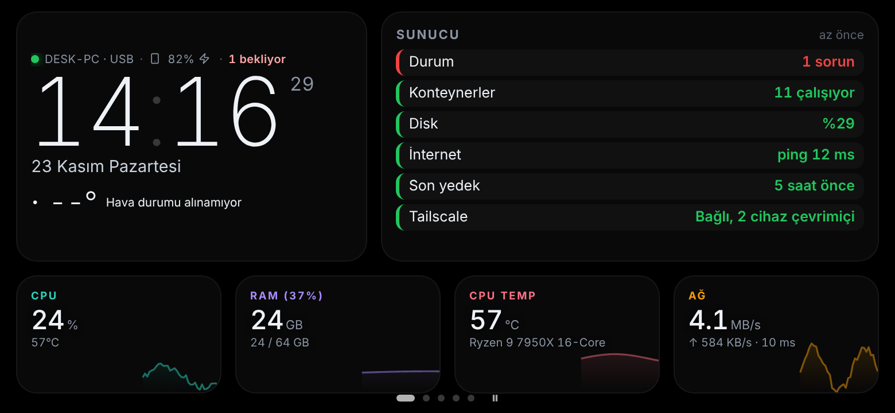
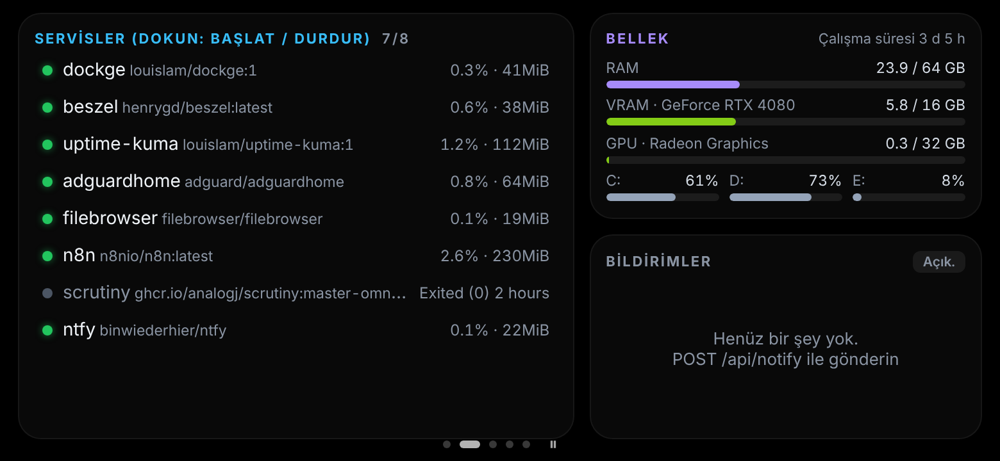
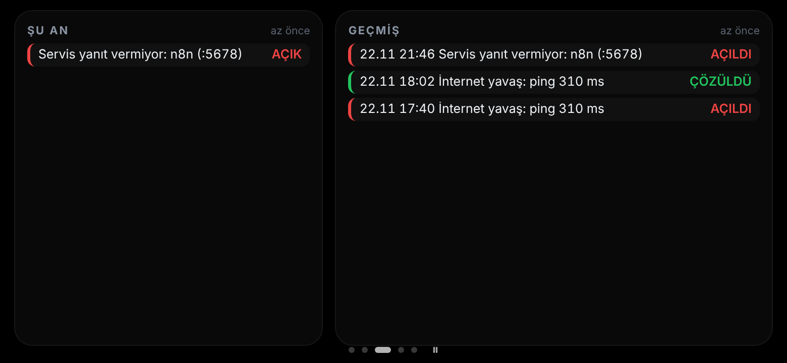
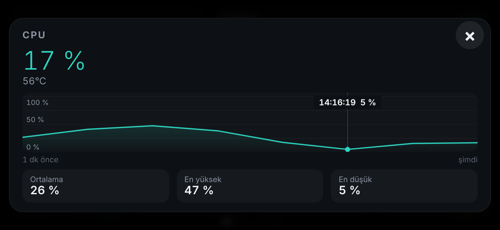
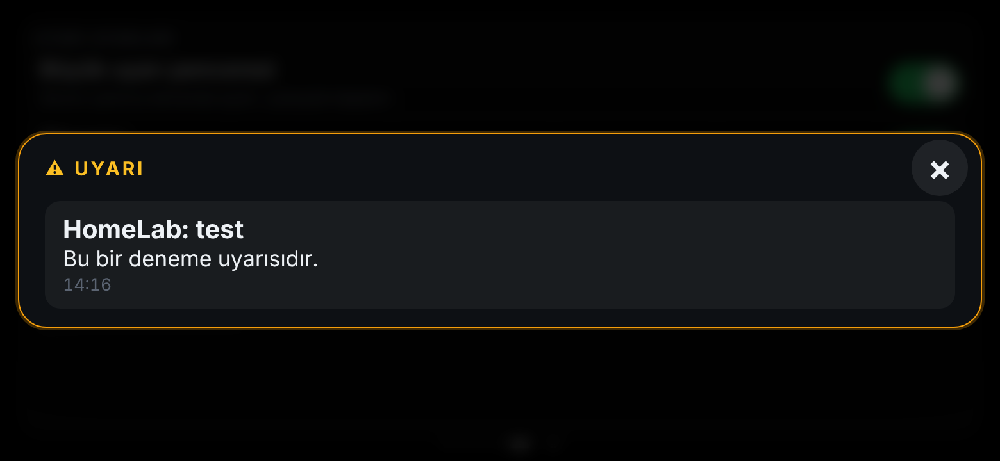
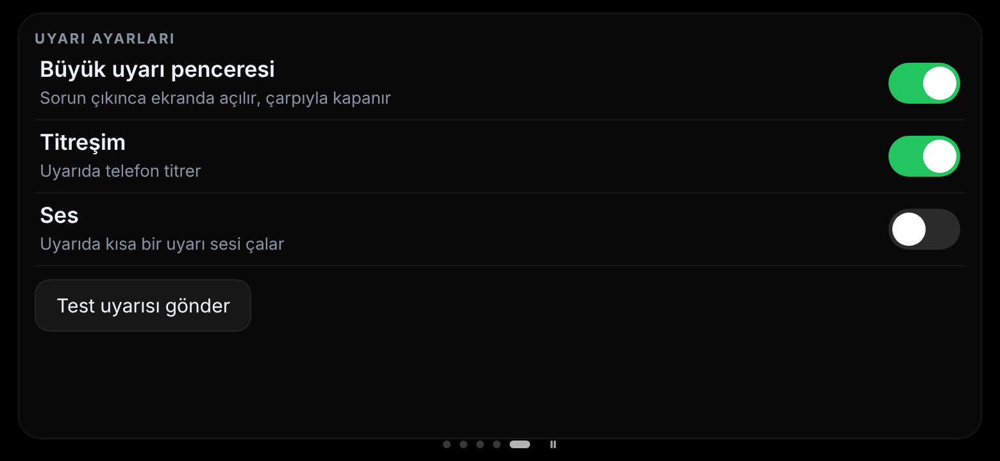
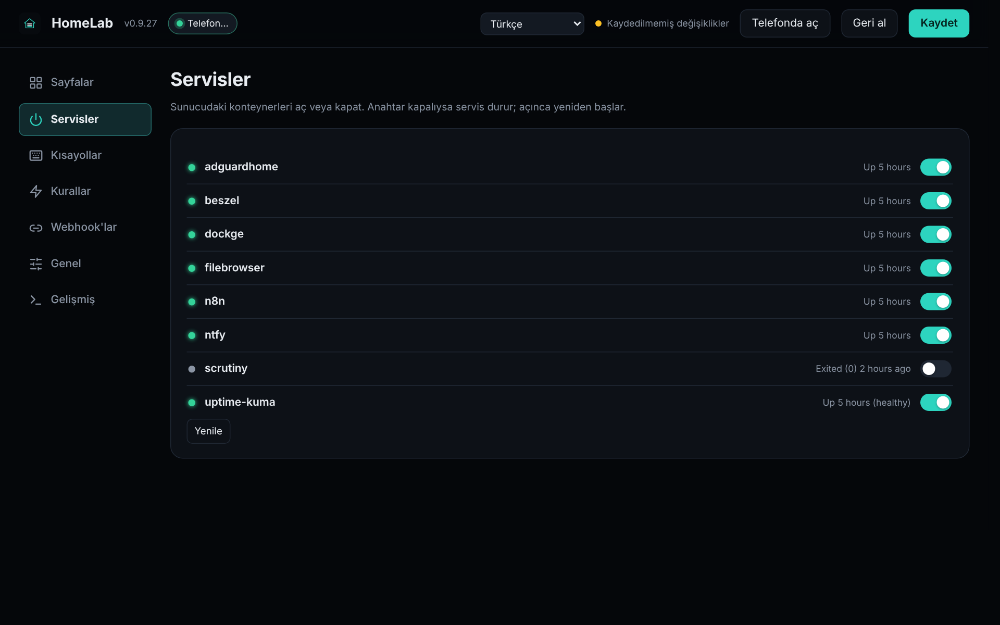

# HomeLab — Tek Paket Kurulum

English: [README.md](README.md) · Depo: https://github.com/Kleanty/HomeLab

**İlk kez kuruyorsan önce [`KURULUM-REHBERI.md`](KURULUM-REHBERI.md) dosyasını oku.** Bu paket, Linux Mint 22.x'i yeni bilgisayara kurduktan sonra çalıştırılır; işletim sistemini kendisi kurmaz.

Bu paket, **Linux Mint 22.x Cinnamon 64-bit (Ubuntu 24.04 / noble, amd64)** kurulmuş yeni bir bilgisayarı temel HomeLab sunucusuna dönüştürmek için hazırlanmıştır.

> **Önemli:** Bu paket Linux Mint işletim sistemini USB'den kendi kendine kurmaz. Önce Linux Mint'i bilgisayara kurup masaüstüne giriş yapmalısın. Ardından paketi açıp `KUR.sh` dosyasını normal kullanıcı hesabınla çalıştırırsın. Mevcut bir HomeLab sunucusunda doğrudan çalıştırmadan önce yedek al ve mevcut Compose dosyalarını incele.

## Ekran görüntüleri

Aşağıdakiler demo verileriyle alınmış örnek görüntülerdir.

| | |
|---|---|
|  |  |
|  |  |
|  |  |

Sunucudaki ayar sayfası (`http://127.0.0.1:8765`, sunucunun kendi tarayıcısında açılır; kurulumda seçtiğin kullanıcı adı ve parolayı sorar): servisleri aç/kapat anahtarıyla yönetirsin.



## Test durumu ve lisans

Kurulum Linux Mint 22.x üzerinde gerçek bir makinede test edilmiştir (RustDesk dahil). Kendi donanımında ilk kurulumdan sonra `bash TANI.sh` ile durumu kontrol et.

Bu proje [MIT Lisansı](LICENSE) ile paylaşılır. Yazılım "olduğu gibi" sunulur; kullanım sorumluluğu sana aittir.

## Neler kurulur?

### Sistem paketleri ve servisleri

- Docker Engine, Docker Compose ve Buildx
- OpenSSH Server
- Samba dosya paylaşımı
- Syncthing
- Fail2ban (SSH için temel brute-force koruması)
- Restic (şifreli yedekleme aracı; otomatik görev için harici hedef gerekir)
- SQLite3 (çalışan SQLite veritabanlarının tutarlı kopyalarını hazırlamak için)
- smartmontools, nvme-cli ve lm-sensors (disk/NVMe/sensör teşhisi)
- systemd-journald günlükleri kalıcı tutulur; toplam boyut 500 MB ve saklama süresi 1 ay ile sınırlandırılır
- UFW paketi (güvenlik duvarı **etkinleştirilmez**)
- Docker log rotasyonu: yeni kurulumda `local` sürücüsü, 10 MB ve en fazla 3 dosya; mevcut `daemon.json` varsa korunur
- Donanım algılama: CPU/RAM/ekran kartı ve diskler yalnızca bilgi amaçlı listelenir. **Ekran kartı (NVIDIA) sürücüsü bu pakette kurulmaz.**
- Ollama: ilk kurulumda sabit [`qwen2.5:1.5b-instruct-q4_K_M`](https://ollama.com/library/qwen2.5/tags) modeli indirilir (dosya yaklaşık 986 MB) ve **CPU üzerinde** çalışır. Yalnızca 2 GiB altı boş disk alanında indirme atlanıp neden raporlanır; daha sonra kullanıcı istediği modeli ayrıca ekleyebilir.
- Avahi/mDNS: yerel ağda destekleyen cihazlardan `bilgisayar-adi.local` adıyla erişim denenebilir; router'da sabit IP ayarı yapılmaz
- Docker port kilidi: `homelab-docker-lan-only` servisi, Docker'ın yayınladığı portlara internet kaynaklı yeni bağlantıları engeller; yerel ağ (10/8, 172.16/12, 192.168/16), Tailscale (100.64/10) ve localhost açık kalır. Yalnızca Docker trafiğini etkiler (IPv4); yayınlanan portlar IPv4'e sabitlenmiştir. Host ağını kullanan Beszel Agent (45876) bu filtrenin dışındadır. SSH/Samba/UFW değişmez
- **HomeLab Panel** (telefon paneli): eski bir Android telefonu sunucu paneline çevirir. HomeLab ajanı bu depodan (`agent/`) GitHub Actions ile derlenip `v<sürüm>` sürümüne yüklenir; KUR.sh onu indirir, SHA-256 doğrular ve systemd kullanıcı servisi (`homelab-agent`) olarak çalıştırır; kendi kendine güncellenmez. adb de kurulur (USB ile bağlantı için). İlk kurulumda 6 sayfa hazırlanır: HomeLab (saat, durum listesi, CPU/RAM/sıcaklık/ağ), Servisler (konteynere dokun: başlat / durdur / yeniden başlat), Uyarılar (açık sorunlar ve geçmiş), Sistem, Süreçler ve Kısayollar. Ekran kartı sıcaklığı için üretici sürücüsü gerekir; kurulum NVIDIA sürücüsü kurmadığından varsayılan olarak GPU göstergesi yoktur. Kartlara dokununca büyük grafik penceresi açılır. Sağlık kontrolü 2 dakikada bir internet (ping) ve servisleri denetler; sorun olursa telefonda büyük uyarı açılır. Sunucuda `http://127.0.0.1:8765` adresindeki HomeLab ayar sayfasından sayfaları düzenler, **Servisler** sekmesinden Docker konteynerlerini aç/kapat anahtarıyla başlatıp durdurursun (telefon panelinin Servisler sayfası da aynısını yapar; kullanıcın `docker` grubunda olmalı, bu yüzden kurulumdan sonra bir kez oturumu kapatıp yeniden aç). Arayüz Türkçe, AMOLED + turkuaz temadadır.
- Tailscale ve RustDesk (uzaktan masaüstü; modemde port açmadan bağlanır)
- Sunucunun uyumaması için uyku/askıya alma kilidi (güç düğmesi ayarı korunur) ve otomatik oturum açma (LightDM; zaten ayarlıysa dokunulmaz)

### Docker servisleri

| Servis | Adres / port | Açıklama |
|---|---|---|
| Dockge | `http://SUNUCU-IP:5001` | Docker Compose yönetimi |
| Beszel Hub | `http://SUNUCU-IP:8090` | Sistem ve konteyner izleme merkezi |
| Uptime Kuma | `http://SUNUCU-IP:3001` | Servis erişilebilirliği ve uptime |
| Scrutiny | `http://SUNUCU-IP:8081` | HDD/SSD/NVMe SMART sağlık takibi |
| File Browser | `http://SUNUCU-IP:8080` | Dosya arayüzü |
| n8n | `http://SUNUCU-IP:5678` | Otomasyon |
| Ollama API | `http://127.0.0.1:11434` | Yalnızca sunucunun localhost adresi; Qwen modeli RAM/disk kontrolünden sonra otomatik indirilir |
| Kendi web siten (Caddy) | `http://127.0.0.1:8088` | Kendi siteni koyman için boş yer tutucu sayfa; Caddyfile/compose portunu değiştirmedikçe yalnızca 127.0.0.1'de dinler; alan adı/HTTPS daha sonra yapılandırılır |
| AdGuard Home | IP'ye göre `:3000`, sonra `:3002`; DNS `:53` | İsteğe bağlı; yalnızca seçilen LAN IP'sine bağlanır |

AdGuard Home kurulum sırasında ayrıca sorulur. Router'ın DNS/DHCP ayarları değiştirilmez ve AdGuard DHCP sunucusu açılmaz.

### Beszel Agent

Beszel Hub otomatik kurulur. Agent Compose dosyası da hazırlanır; Agent, Hub'daki ilk yönetici hesabı ve sistem kaydı oluşturulduktan sonra anahtar/token gerektirdiği için ayrı bir yardımcıyla başlatılır:

```bash
bash /srv/homelab/tools/configure-beszel-agent.sh
```

Önce `http://SUNUCU-IP:8090` adresini aç, Beszel'de **Add System** üzerinden sistem kaydı oluştur ve Hub'ın verdiği KEY/TOKEN değerlerini al. Yardımcı bunları root tarafından okunabilen `0600` izinli bir `.env` dosyasına yazar ve Agent konteynerini başlatır. Hub tarafında sunucunun LAN IP'sini ve `45876` portunu kullan. Agent bir panelden başlatılıp durdurulmaz; konteyneri oluştuktan sonra telefon panelinin ve ayar sayfasının Servisler listesinde görünür.

Agent konteyneri Docker istatistikleri için `/var/run/docker.sock` soketini salt okunur bağlar. Docker soketine salt okunur dosya bağlamak API erişimini tam anlamıyla salt okunur hâle getirmez; Docker soketi yüksek yetkili bir arayüzdür. Bu nedenle Agent sadece güvendiğin yerel sunucuda çalıştırılmalı, portu internete yönlendirilmemelidir.

### Scrutiny disk erişimi

Kurulum, `lsblk` ile fiziksel diskleri tespit edip yalnızca bu diskleri (USB/çıkarılabilir diskler ve zram hariç; çıkarılınca konteyner başlayamaz) Scrutiny konteynerine `/dev/...` eşlemesiyle verir. SATA/SAS diskler kendi aygıt yollarıyla; NVMe diskler ise Scrutiny belgelerinin istediği NVMe denetleyici aygıtıyla aktarılır. `SYS_RAWIO` yetkisi eklenir. NVMe algılanırsa `SYS_ADMIN` yetkisi isteğe bağlı olarak sorulur; varsayılan tercih **Hayır** olmalıdır. Bu yetki geniş kapsamlıdır ve yalnızca NVMe SMART verileri alınamıyorsa ayrıca değerlendirilmelidir. `--privileged` kullanılmaz.

Scrutiny'nin boş görünmesi, diskin SMART verisini desteklemediği, USB köprüsünün SMART geçişini engellediği veya NVMe için ek yetkinin gerekebildiği anlamına gelebilir. RAID/USB dönüştürücülerinde her disk için SMART verisi garanti değildir.

## Restic otomatik yedekleme

Restic paketi kurulur; otomatik yedekleme hedefi için kurulum sonunda harici disk sorulur. Harici disk bağlı değilse bu adım atlanabilir:

```bash
sudo bash /srv/homelab/tools/setup-restic-backup.sh
```

Araç:

1. Ayrı bağlanmış bir dosya sisteminde bulunan yedek deposu yolunu ister. `/srv/homelab` içine veya sistem diskinin kök dosya sistemine yedek oluşturmayı reddeder; kaynaklar blok aygıtıysa sistem diskiyle aynı fiziksel diske ait olup olmadıklarını da kontrol eder.
2. En az 20 karakterli Restic şifreleme parolasını iki kez alır.
3. Parolayı `/etc/restic/homelab-password` dosyasında root erişimli `0600` izinle saklar. Parolayı ayrıca güvenli parola kasasına kaydet; bu parola kaybolursa yedek açılamaz.
4. Restic deposunu başlatır ve günlük yedekleme ile haftalık bütünlük kontrolü zamanlayıcılarını etkinleştirir.

Zamanlama ve saklama politikası:

- Her gün yaklaşık 03:15'te yedek; açılışta kaçırılan görevleri telafi eder.
- 14 günlük, 8 haftalık ve 12 aylık snapshot saklama; eski snapshot temizliği ve `prune` yedek görevinin sonunda yapılır.
- Haftalık Restic depo bütünlük kontrolü.
- Yedek diski masaüstü oturumu ile `/media/...` veya `/run/media/...` altına bağlanıyorsa kurulum uyarı verir. Sistem oturumu açılmadan çalışan zamanlayıcının diski görebilmesi için sabit ve açılışta bağlanan bir mount noktası (tercihen UUID tabanlı `/etc/fstab` veya systemd mount) gerekir. Kurulum bu kritik sistem dosyasını kendiliğinden değiştirmez.
- SQLite veritabanları için canlı veritabanından `sqlite3 .backup` ile tutarlı kopya hazırlanmaya çalışılır.
- `/srv/homelab`, SSH/Samba yapılandırmaları ve kullanıcının `.ssh` dizini kapsama alınır.

İlk yedeği elle başlat:

```bash
sudo systemctl start homelab-restic-backup.service
sudo systemctl status homelab-restic-backup.service --no-pager
sudo journalctl -u homelab-restic-backup.service -n 100 --no-pager
```

Snapshot listesini ve örnek geri yüklemeyi kontrol et:

```bash
sudo bash -c 'set -a; . /etc/restic/homelab.env; set +a; restic snapshots'
sudo mkdir -p /tmp/homelab-restore-test
sudo bash -c 'set -a; . /etc/restic/homelab.env; set +a; restic restore latest --target /tmp/homelab-restore-test --include /srv/homelab/web/public/index.html'
```

Geri yükleme testinden sonra geçici `/tmp/homelab-restore-test` dizinini silebilirsin. Bu örnek yalnızca tek bir küçük web dosyasını geri yükler; tüm yedeği geçici dizine açıp sistemi doldurmaz. `--include` yolu snapshot içindeki yolla eşleşmelidir; kendi dosyan için `restic ls latest` çıktısını esas al.

Zamanlayıcıları kontrol et:

```bash
systemctl list-timers 'homelab-restic*'
```

### Tam geri yükleme (yeni kurulmuş makinede)

1. Normal `KUR.sh` kurulumunu tamamla, harici yedek diski bağla ve `/etc/restic/homelab.env` ile parola dosyasını (`/etc/restic/homelab-password`) yeniden oluştur. Parola yoksa yedek açılamaz.
2. Servisleri durdur: `cd /srv/homelab && sudo docker compose -f <stack>/docker-compose.yml down` (her stack için).
3. Önce geçici dizine aç ve içeriği kontrol et: `sudo bash -c 'set -a; . /etc/restic/homelab.env; set +a; restic restore latest --target /srv/restore-tmp'`
4. SQLite veritabanları canlı dosya yerine tutarlı anlık görüntü olarak yedeklenir: `/srv/restore-tmp/var/lib/homelab-restic/staging/sqlite/.../<ad>.snapshot`. Bir veritabanını geri koyarken ilgili `.snapshot` dosyasını asıl yola (`/srv/homelab/appdata/...`) özgün adıyla kopyala; servis çalışırken kopyalama.
5. Geri kalan dosyaları `/srv/restore-tmp/srv/homelab` altından `/srv/homelab` içine `sudo rsync -a` ile taşı, sonra servisleri tekrar başlat.
6. Bu adımlar gerçek bir makinede denenmedi; ilk yedekten sonra boş bir dizinde deneme geri yüklemesi yap.

Yedek hedef diski bağlı değilse görev bilerek başarısız olur; sistem diskine sessizce yedek yazmaz. Ollama model dosyaları da `/srv/homelab` altında olduğundan yedeğe girer ve ilk yedek büyük olabilir. Harici diskin kapasitesini buna göre seç. Yedekleme tamamlandıktan sonra farklı bir konuma geri yükleme testi yap; yedek alınıyor olması tek başına geri yüklenebildiğini kanıtlamaz.

Restic deposunu SMB/CIFS paylaşımında tutmak yerine doğrudan USB/SATA disk veya uygun SFTP/S3/REST hedefi kullanılması tercih edilir. Parola ve yedek deposunu aynı fiziksel diskte tek kopya olarak tutma.

## 1. Linux Mint'i kur

1. Linux Mint 22.x Cinnamon 64-bit ISO'yu https://linuxmint.com/download.php adresinden indir.
2. USB'yi Mint USB Image Writer veya Balena Etcher ile hazırla.
3. Bilgisayarı USB'den başlat ve Linux Mint'i kur.
4. Kurulumda disk silme seçeneği kullanırsan doğru diski seç; o diskteki veriler silinir.
5. Normal bir kullanıcı oluştur, masaüstüne giriş yap, interneti bağla ve güncellemeleri tamamla.

## 2. Paketi aç ve çalıştır

ZIP'i aç. `KUR.sh`, `setup-restic-backup.sh`, `configure-beszel-agent.sh` ve diğer yardımcı dosyalar aynı ana klasörde kalmalı.

```bash
chmod +x KUR.sh
./KUR.sh
```

`sudo` parolanı sorabilir. Kurulum başında önce **Language / Dil** (English veya Türkçe) sorulur; seçim tüm kurulum mesajları, bildirimler ve yardımcı betikler için kullanılır. Ardından bir kullanıcı adı ve bir parola ister (parola iki kez sorulur, en az 14 karakter; kısa ya da uyuşmuyorsa nedenini söyleyip tekrar sorar). Aynı parola ayar sayfası girişi, Samba, RustDesk, ntfy ve Syncthing için kullanılır; Samba kullanıcı adı olarak Linux hesabını kullanır. Sonrası soru sormadan ilerler. Kurulum boyunca terminali kapatma. Kurulum günlüğü `~/HomeLab_Logs/kurulum-*.log` altında tutulur; kurulum sonunda IP, bağlantılar, RustDesk ID'si ve ntfy bilgileri `~/HomeLab_Logs/kurulum-ozeti-*.txt` dosyasına yazılır ve ekranda gösterilir (gizli bilgi içerir, günlüğe yazılmaz). Bir hata oluşursa terminalde hata satırı, çıkış kodu, komut ve günlük yolu gösterilir. Günlüğü paylaşmadan önce özel IP veya kullanıcı adı gibi bilgileri gözden geçir.

Kurulumdan sonra bir kez oturumu kapatıp yeniden aç (docker ve plugdev grupları): USB eşleştirme ve Docker kontrolü ancak bundan sonra çalışır.

Kurulum sırasında:

- Tailscale, RustDesk, AdGuard, otomatik güvenlik güncellemesi ve Timeshift anlık görüntüsü soru sorulmadan kurulur/alınır. Tailscale girişi için kurulum sonundaki özette çıkan bağlantıyı tarayıcıda açmak gerekir (kurulum beklemez). Restic harici disk gerektirdiği için ayrı araçla kurulur.
- AdGuard Home otomatik kurulur; sunucunun yerel ağ IPv4 adresi otomatik bulunur (bulunamazsa atlanır ve uyarı yazılır).
- İşlemci, RAM, ekran kartı ve diskler otomatik algılanıp listelenir; ekran kartı sürücüsü veya GPU yapılandırması yapılmaz, Ollama CPU ile çalışır.
- RAM miktarından bağımsız olarak ilk kurulumda açıkça `qwen2.5:1.5b-instruct-q4_K_M` indirilir. Resmî Ollama kütüphanesindeki model dosyası yaklaşık 986 MB'dır. Yalnızca HomeLab diskinde 2 GiB'tan az boş alan varsa depolamayı korumak için indirme atlanır ve uyarı gösterilir. İhtiyaç olursa kullanıcı daha sonra başka modeli elle indirebilir.
- Scrutiny için disk listesi tespit edilir; NVMe varsa ek yetki verilip verilmeyeceği sorulur.
- Kullanıcı adı ve en az 14 karakterli parola alınır (ayar sayfası girişi de bunlardır).
- Samba için de aynı parola kullanılır (kullanıcı adı Linux hesabıdır).
- Harici yedek diskin bağlıysa Restic otomasyonu yapılandırılabilir.
- Tailscale seçildiyse oturum açma adımı kurulum sonunda sorulur.
- Cinnamon güç düğmesi, önceki kullanıcı tercihi yedeklenerek doğrudan kapatmaya ayarlanır; systemd ayarı için yeniden başlatma gerekir.

Paketler ve Docker imajları internetten indirilir. Bağlantı hızına göre kurulum sürebilir.
Bir Docker stack'i başlayamazsa (imaj indirilemedi, port çakıştı vb.) kurulum durmaz; uyarı listesine yazılır ve sonda hangi stack'in elle başlatılması gerektiği gösterilir.

## 3. Kurulum sonrası ilk adımlar

Herhangi bir servis başlamazsa paket içindeki `TANI.sh` dosyasını normal kullanıcıyla çalıştır:

```bash
bash TANI.sh
```

Rapor `~/HomeLab_Logs/tani-*.txt` altında oluşur. Bu rapor servis durumlarını, Docker konteynerlerini, Compose doğrulamalarını, portları ve Restic/Agent durumunu kontrol eder; parola ve token değerlerini yazdırmaz.


1. `http://SUNUCU-IP:8090` adresinde Beszel Hub yönetici hesabını oluştur.
2. Hub'da **Add System** ile sistem kaydını başlat; verilen anahtar ve token ile `configure-beszel-agent.sh` aracını çalıştır.
3. `http://SUNUCU-IP:8081` adresinde Scrutiny disk durumunu kontrol et.
4. AdGuard seçildiyse `http://ADGUARD-LAN-IP:3000` üzerinden ilk kurulum sihirbazını tamamla. Kurulumdan sonra yönetim arayüzü `http://ADGUARD-LAN-IP:3002` adresindedir. İstemcilerin DNS ayarlarını ancak test ettikten ve sunucu IP'sini DHCP reservation/statik IP ile sabitledikten sonra elle değiştir.
5. Kendi web siteni (Caddy; kendi siteni koyman için boş yer tutucu sayfa) sunucunun kendisinde `http://127.0.0.1:8088` üzerinden kontrol et. Web dosyaları `/srv/homelab/web/public`, Caddy yapılandırması `/srv/homelab/config/caddy/Caddyfile` altındadır. Temiz kurulumda bu içerikler normal Linux hesabın tarafından düzenlenebilir. Caddyfile değişikliğinden sonra `sudo docker compose -f /srv/homelab/compose/web/compose.yaml exec caddy caddy reload --config /etc/caddy/Caddyfile` komutuyla yapılandırmayı yeniden yükle.
6. Restic yapılandırıldıysa ilk yedeği başlat ve sistemd günlüğünü kontrol et.

### Bildirim, güvenlik ve bakım araçları

- **ntfy (bildirim, `http://SUNUCU-IP:2586`):** Kurulum rastgele bir konu adı ve `homelab` kullanıcısı oluşturur (`sudo cat /etc/homelab-installer/ntfy.env`). Telefondaki ntfy uygulamasına sunucu adresini, bu kullanıcıyı ve konuyu ekle. Ev dışında almak için Tailscale gerekir. `homelab-health-check` her 10 dakikada disk %90 üstü, başarısız servis, duran konteyner ve 48 saatten eski yedeği denetler; yalnızca yeni sorunda ve düzelince haber verir. Restic yedek/kontrol servisleri başarısız olunca da bildirim gider.
- **Timeshift:** Kurulumdan önce sistem anlık görüntüsü alınmasını önerir (Timeshift önceden ayarlanmış olmalı).
- **Otomatik güvenlik güncellemeleri (isteğe bağlı):** Yalnızca Ubuntu güvenlik deposu; Docker paketleri dışlanır; otomatik yeniden başlatma yok. Mint'te varsayılan ayar eşleşmediği için kaynak açıkça yazılır.
- **SSH anahtar girişi:** `bash /srv/homelab/tools/harden-ssh.sh` anahtarını ve izinleri denetler, anahtarla girişi doğruladığını yazmanı ister, sonra parola girişini kapatır. Geri almak için `--geri-al`.
- **Web girişi sıfırlama:** ayar sayfası girişini unutursan `bash /srv/homelab/tools/reset-web-login.sh` çalıştır (yeniden başlatma gerekmez).

### İlk girişte hemen yapılacaklar

Dockge, Beszel, Uptime Kuma ve n8n ilk açanın yönetici hesabını oluşturmasına izin verir; kurulumdan hemen sonra kendin oluştur. File Browser kullanıcı adı `admin`, ilk parola rastgele üretilip günlüğe yazılır (`sudo docker logs filebrowser`). Scrutiny'de giriş ekranı yoktur. Syncthing arayüzüne (127.0.0.1:8384) parola ekle. Kurulum sonunda aynı liste ekrana yazdırılır.

## 4. HomeLab ayar sayfası girişi

- Tek HomeLab web sayfası ajanın ayar sayfasıdır: `http://127.0.0.1:8765`, sunucunun kendi tarayıcısında.
- Giriş ister (HTTP Basic; tarayıcı oturum başına bir kez sorar): kurulumda seçtiğin kullanıcı adı ve parolanın aynısı.
- Giriş bilgisi `~/.config/HomeLab/web-login` dosyasında PBKDF2 hash olarak saklanır (izin 600).
- Uyarı gönderen yerel betikler (`/api/info`, `/api/notify`, `/api/push`) port yalnızca loopback olduğu için girişsiz açık kalır.
- Ayarların ve telefon panelinin **Servisler** sayfası Docker konteynerlerini başlatır/durdurur; kullanıcın `docker` grubunda olmalı (kurulumdan sonra bir kez oturumu kapatıp yeniden aç).
- Girişi unutursan: `bash /srv/homelab/tools/reset-web-login.sh` (yeniden başlatma gerekmez).

Docker grubuna eklenen Linux hesabının Docker üzerinden root seviyesine yakın yetkiler elde edebileceğini unutma. Kurulum ilk üyeliği kaydeder; kaldırma sırasında yalnızca bu paket tarafından eklenmiş üyeliği geri alır.

## 5. Veri ve yapılandırma konumları

- Compose dosyaları: `/srv/homelab/compose/`
- Kalıcı uygulama verileri: `/srv/homelab/appdata/`
- Paylaşılan dosyalar: `/srv/homelab/data/`
- Web sitesi dosyaları: `/srv/homelab/web/public/`
- Caddy yapılandırması: `/srv/homelab/config/caddy/Caddyfile`
- Yardımcı kurulum araçları: `/srv/homelab/tools/` (`setup-restic-backup.sh`, `configure-beszel-agent.sh`, `reset-web-login.sh`, `harden-ssh.sh`, `lang.sh`)

Compose dosyaları root sahipliğinde tutulur; değişiklik yapmak için `sudo` kullan. Mevcut Compose dosyalarının üzerine yazılmaz. Mevcut data klasörlerine geniş kapsamlı `chown -R` uygulanmaz.

## 6. Güvenlik ve dış erişim sınırları

- UFW paketi kurulur ancak güvenlik duvarı etkinleştirilmez; yanlış kural SSH/RustDesk erişimini kesebilir.
- Fail2ban SSH giriş denemelerine karşı etkinleştirilir.
- Docker servislerinin bazıları LAN arayüzlerinde port yayınlar. Router üzerinde 22, 445, 5001, 8090, 3001, 8081, 8080, 5678, 53 veya 45876 portlarını internete yönlendirme.
- Önemli: Docker'ın yayınladığı port trafiği UFW kurallarını atlayabilir. Yalnızca `ufw enable` demek bu konteyner portlarını güvenceye almaz; internet erişimi öncesinde Docker `DOCKER-USER` zinciri ve LAN/Tailscale erişim politikası ayrıca tasarlanmalıdır.
- Kendi web siten (Caddy), Caddyfile/compose portunu değiştirmedikçe yalnızca `127.0.0.1:8088` üzerinde sunulur.
- AdGuard seçilen LAN IP'sine bağlanır; router DNS veya DHCP ayarı değiştirilmez.
- Cloudflare hesabına bağlanılmaz, DNS kaydı/Tunnel/Access politikası oluşturulmaz.
- Ev bağlantısında sabit genel IP gerekmez; Cloudflare Tunnel sunucudan dışarı bağlantı kurar. Ancak alan adının Cloudflare DNS'inde olması, Tunnel token'ı ve hostname eşlemesi gerekir; bunlar sonraki aşamada kullanıcı tarafından sağlanacaktır. Yerel ağ IP'si DHCP ile değişebilir; router'da DHCP rezervasyonu isteğe bağlıdır. mDNS destekleyen cihazlarda `bilgisayar-adi.local` adı denenebilir.
- Genel web sitesi için alan adı, HTTPS, Cloudflare Tunnel ve Access yapılandırması sonraki ayrı aşamadır.

Önerilen son mimari:

- `alanadiniz.com`: genel kişisel web sitesi

Cloudflare tarafı ayrıca yapılandırılmadan dış erişime açma.

## 7. Mevcut kurulumun üzerine çalıştırma

Bu paket öncelikle **temiz Linux Mint 22.x kurulumu** için tasarlanmıştır. Bazı işlemler tekrar çalıştırılabilir:

- Var olan Compose YAML dosyalarının üzerine yazılmaz.
- Var olan uygulama verileri silinmez.
- Eksik yeni servis stack dosyaları eklenir.

Bununla birlikte mevcut Compose projeleri `up -d` ile yeniden uygulanır; Docker daemon ayarı, servis sürümleri ve mevcut konteyner davranışı değişebilir. Mevcut sunucuda doğrudan çalıştırmadan önce `/srv/homelab` ve Docker yapılandırmalarını yedekle. Daha önce farklı biçimde kurulmuş Beszel Hub'a Agent ekleme ve AdGuard port/IP çakışmaları ayrıca kontrol edilmelidir.

## 8. Kontrol komutları

```bash
sudo docker ps
sudo docker compose ls --all
sudo systemctl status fail2ban ssh smbd docker systemd-journald --no-pager
sudo timedatectl status
sudo nvme list
sudo systemctl status homelab-restic-backup.timer homelab-restic-check.timer --no-pager
```

## 9. Bilinen sınırlar / sonraki aşamalar

- Linux Mint işletim sistemi USB'den otomatik kurulmaz.
- Ekran kartı sürücüsü ve GPU hızlandırma bu pakette yoktur; Ollama her zaman CPU üzerinde çalışır. İstersen sürücü ve NVIDIA Container Toolkit kurulumunu sonradan elle yapabilirsin.
- Model seçimi donanıma göre değiştirilmez; her kurulum `qwen2.5:1.5b-instruct-q4_K_M` modelini kullanır. CPU üzerinde yanıt hızı işlemciye ve RAM'e bağlıdır.
- AdGuard DNS ayarı router'a otomatik uygulanmaz; statik DHCP rezervasyonu ve istemci DNS ayarı kullanıcı tarafından yapılır.
- Caddy alan adı, HTTPS ve Cloudflare Tunnel yapılandırmasını kendiliğinden yapmaz.
- Scrutiny, USB-SATA köprüleri veya RAID denetleyicilerinin SMART geçişini garanti edemez.
- UPS/NUT yapılandırması, gerçek bir UPS modeli ve bağlantı türü bilinmeden eklenmez.
- Otomatik işletim sistemi güncellemesi etkinleştirilmez; Mint Update Manager üzerinden güncellemeleri kontrollü yürüt. Sunucuya güvenlik duvarı ve SSH anahtar politikası ayrıca uygulanmalıdır.
- Beszel Agent'ın Docker istatistikleri için Docker socket erişimi gerekir; bu yüksek ayrıcalıklı erişimdir.
- RustDesk, resmî GitHub sürümlerinden (.deb) indirilir; GitHub sağlama toplamı (digest) verirse SHA-256 doğrulanır, sonra apt ile kurulur. İndirme veya doğrulama başarısızsa kurulum atlanır ve uyarı yazılır.
- RustDesk kalıcı parolası kurulum başında sorulur ve `rustdesk --password` ile ayarlanır (komut çalışırken parola kısa süre işlem listesinde görünebilir). Ayarlanamazsa uyarı çıkar; RustDesk > Ayarlar > Güvenlik'ten elle belirleyebilirsin.
- Monitörsüz (headless) çalışmada ekran siyah gelebilir; HDMI/DisplayPort 'dummy' fiş tak. Linux Mint Cinnamon X11 kullandığından RustDesk uyumludur (Wayland oturumunda sınırlıdır).
- Uyku engeli: sleep/suspend/hibernate hedefleri maskelenir, kapak kapanışı ve boşta uyku yok sayılır, Cinnamon'da ekran kapanması ve ekran kilidi kapatılır. Önceki Cinnamon değerleri yedeklenir ve KALDIR.sh ile geri yüklenir. Ekran kilidi kapalı olduğundan bilgisayara fiziksel erişen herkes masaüstünü görür.
- Otomatik oturum açma (LightDM) kurulumda otomatik açılır; bilgisayara fiziksel erişimi olan herkes masaüstüne girebilir.
- GitHub'a yüklerken: .gitignore ve .gitattributes (LF satır sonu) pakette hazırdır; Windows'tan yüklersen çalıştırma izni kaybolur, bu yüzden betikleri `bash KUR.sh` ile çalıştır.


## 10. Önceki HomeLab kurulumunu kaldırma

Temiz Linux Mint kurulumu yaptıysan `KALDIR.sh` dosyasını çalıştırmana gerek yoktur. Bu araç yalnızca aynı bilgisayardaki önceki HomeLab kurulumunu kaldırmak içindir.

Paket içindeki `KALDIR.sh`, bu kurulumun bilinen konteynerlerini, Restic zamanlayıcılarını ve HomeLab'e ait sistem yapılandırmalarını kaldırır. Normal kullanıcıyla çalıştır:

```bash
bash KALDIR.sh
```

İşlem `HOMELAB-KALDIR` onayı ister. Varsayılan olarak `/srv/homelab` içindeki uygulama verilerini, Ollama modellerini, paylaşılan dosyaları, web içeriğini ve yerel yedekleri korur. Tamamen silmek istersen ayrıca `HOMELAB-DATASI-SIL` yazman gerekir. Bu seçim geri alınamaz. Harici Restic deposu hiçbir koşulda silinmez.

Sistem paketlerini kaldırmak ayrı ve ikinci bir tercihtir. Yeni sürüm, kurulumdan önce mevcut paketleri kaydeder ve kaldırma sırasında yalnızca bu kurulumun eklediği paketleri kaldırmayı dener; önceden kurulu paketleri korur. Özellikle OpenSSH kaldırılırsa uzaktan bağlantın kesilebilir. Önceki paketlerde sahiplik kaydı yoksa yanlışlıkla paket silmemek için paket kaldırma adımı atlanır. Bu nedenle yalnızca bilgisayarın başındayken kullan. Paketleri kaldırma seçilmezse KUR.sh sonraki çalıştırmada eksik servisleri yeniden kurabilir.

Kaldırma günlüğü `~/HomeLab_Logs/kaldirma-*.log` altında tutulur. Kurulumun eklediği bazı sistem ayarları işaret dosyalarıyla takip edilir; kaldırma betiği önceden var olan yapılandırmaları mümkün olduğunca korur. Kaldırma betiği bu ortamda gerçek Linux Mint bilgisayarında çalıştırılmadı; yalnızca Bash sözdizimi ve statik içerik kontrolleri yapılmıştır. Kaldırma öncesinde önemli verilerin yedeğini al.

## Telefon ajanı ve uygulaması: derleme sırası

Depo: https://github.com/Kleanty/HomeLab

0. Bir kez: depoda **Settings > Pages > Source: GitHub Actions** seç, sonra **Actions > pages > Run workflow** çalıştır. Telefon eşleştirme QR'ı `https://kleanty.github.io/HomeLab/pair/` sayfasına gider (kod `site/` klasöründe); bu sayfa yayında değilse QR açılmaz.
1. Telefon uygulaması GitHub Actions ile derlenir: **Actions > build-agent > Run workflow** (sonra build-apk). build-agent ajanı derler ve `v<sürüm>` sürümü olarak yayımlar. `KUR.sh` ajanı oradan indirir; bu adım yapılmadan ajan kurulmaz (kurulum bunun dışında devam eder, sonunda uyarır).
2. **Actions > build-apk > Run workflow**: APK'yı derler. İmza anahtarı yoksa debug imzalı APK yalnızca **Artifacts** altında `homelab-panel-apk` olarak çıkar; sürüme eklenmez. Kalıcı imza için Settings > Secrets and variables > Actions altına `HOMELAB_KEYSTORE_BASE64`, `HOMELAB_STORE_PASSWORD`, `HOMELAB_KEY_ALIAS`, `HOMELAB_KEY_PASSWORD` ekle; bu durumda `HomeLab-<sürüm>.apk` ve `SHA256SUMS-<sürüm>.txt` `v<sürüm>` sürümüne eklenir. İmza anahtarını kaybetme ve değiştirme: değişirse telefondaki uygulamayı silip yeniden kurman gerekir. APK'yı telefona gönderip kur ("bilinmeyen kaynaklardan yükleme" izni gerekir).
3. Ajan ve APK'yı aynı sürümden kur (eşleştirme bağlantısı değişti: eski APK yeni QR'ı tanımaz). Telefonu USB ile (geliştirici seçeneklerinde USB hata ayıklama açık) veya Wi-Fi ile (ayar sayfasında "Telefonu Wi-Fi ile eşleştir" QR'ı) bağla.

## Teşekkür ve lisanslar

HomeLab ajanı ve telefon uygulaması, [PhoneBox](https://github.com/ersinkoc/phonebox) projesinin (MIT, © Ersin KOÇ) 0.9.27 sürümünden türetilmiştir; lisans metni `third-party/PhoneBox-MIT-LICENSE.txt` dosyasındadır, üçüncü taraf bileşen bildirimleri `agent/HomeLab.Agent/THIRD-PARTY-NOTICES.txt` içindedir. Diğer kurulan yazılımlar (Docker, AdGuard Home, Beszel, Uptime Kuma, Dockge, n8n, Syncthing, Tailscale, RustDesk vb.) kendi lisanslarıyla gelir. Bu depodaki özgün kısımlar [MIT](LICENSE) ile paylaşılır.
